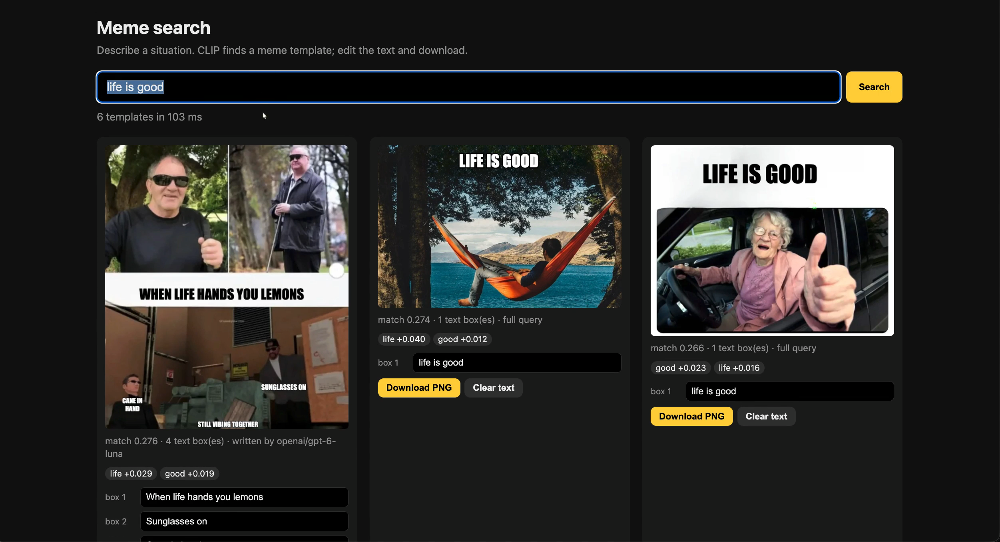

# Computer Vision Recipes

From the YouTube channel **[Neural Breakdown with AVB](https://www.youtube.com/@avb_fj)**.

Four self-contained computer-vision projects to learn from. Each folder has its own code and instructions.

### Meme search — [`meme_search/`](meme_search/)
Describe a situation, get back a blank meme template with its text boxes pre-filled (CLIP fine-tuned on text-free memes).

### PDF parser — [`pdf_parser/`](pdf_parser/)
Detect page layout with a fine-tuned YOLO, then turn each region into structured markdown/JSON with a small VLM.

### Tennis tracking — [`tennis/`](tennis/)
Track the ball, players and court lines from broadcast video with a tiny distilled model.

https://github.com/user-attachments/assets/3b071be0-e0c0-4747-877c-ffd5e5f2cef6

### World model — [`world_model/lightroom/`](world_model/lightroom/)
A playable "dream" of a 2D room: a VQ-VAE tokenizer plus a Genie-style transformer that predicts the next frame from your actions.

https://github.com/user-attachments/assets/e05f140f-9753-4b4f-8452-d41ca88a3fd5

## Support

If you find this helpful, consider supporting on Patreon — it hosts all code, projects, slides, and write-ups from the YouTube channel.

