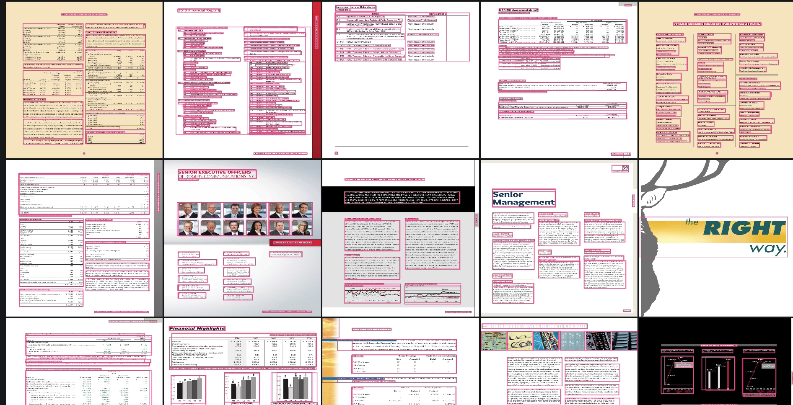
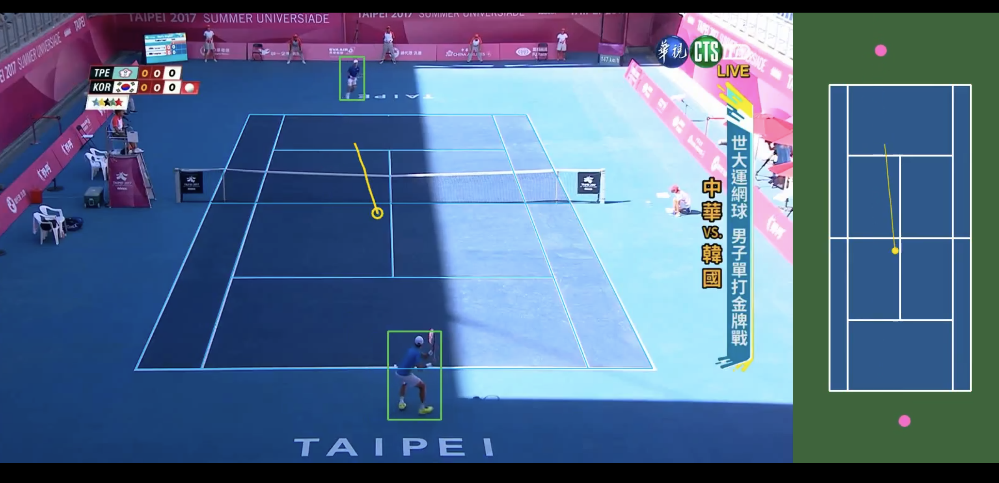
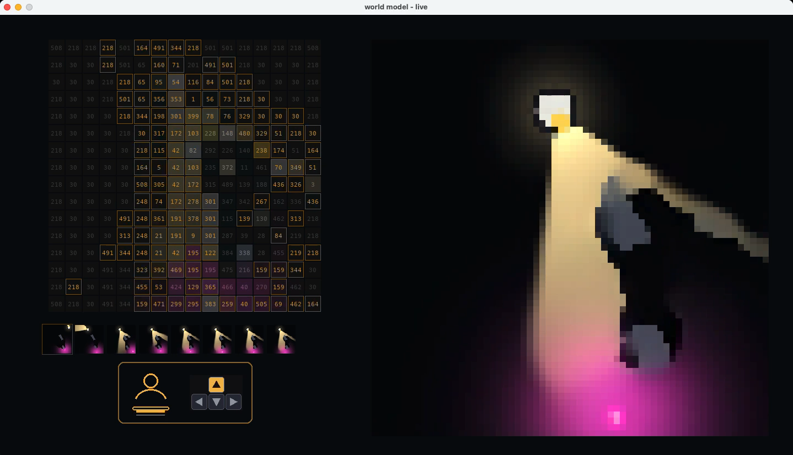

# Computer Vision Recipes

From the YouTube channel **[Neural Breakdown with AVB](https://www.youtube.com/@avb_fj)**.

Four self-contained computer-vision projects to learn from. Each folder has its own code and instructions.

### Meme search — [`meme_search/`](meme_search/)
Describe a situation, get back a blank meme template with its text boxes pre-filled (CLIP fine-tuned on text-free memes).


### PDF parser — [`pdf_parser/`](pdf_parser/)
Detect page layout with a fine-tuned YOLO, then turn each region into structured markdown/JSON with a small VLM.



### Tennis tracking — [`tennis/`](tennis/)
Track the ball, players and court lines from broadcast video with a tiny distilled model.



### World model — [`world_model/lightroom/`](world_model/lightroom/)
A playable "dream" of a 2D room: a VQ-VAE tokenizer plus a Genie-style transformer that predicts the next frame from your actions.



## Notes

Datasets, model weights, training runs and rendered media are not in the repo; each project's scripts regenerate or download them.
Tennis: `bash tennis/setup.sh`, then follow [`tennis/README.md`](tennis/README.md).

## World model quick start

```bash
cd world_model/lightroom
./record_all.sh && python pack.py      # record + pack episodes
./train_vq_ft.sh                       # tokenizer (see vqvae.py for the v2 losses)
./train_wm.sh                          # tokenize + world model
python play_dream.py --wm runs/dyn_k4/best.pt   # play: real room vs. dream
```

## Support

If you find this helpful, consider supporting on Patreon — it hosts all code, projects, slides, and write-ups from the YouTube channel.

[](https://www.patreon.com/NeuralBreakdownwithAVB)
